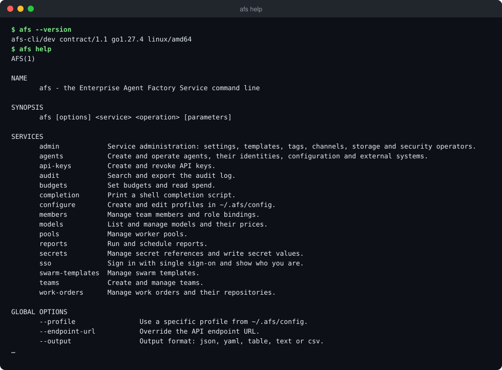
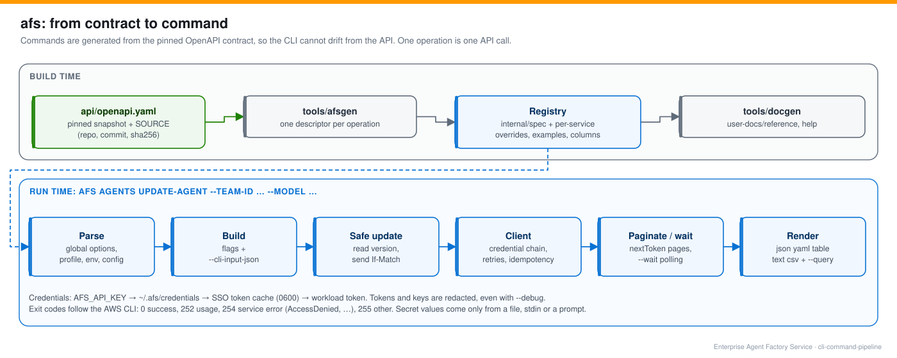
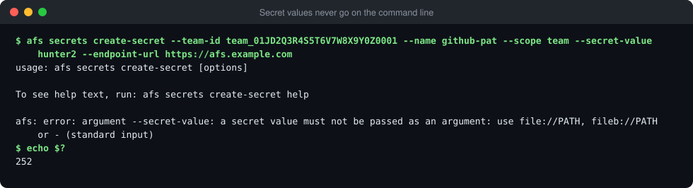
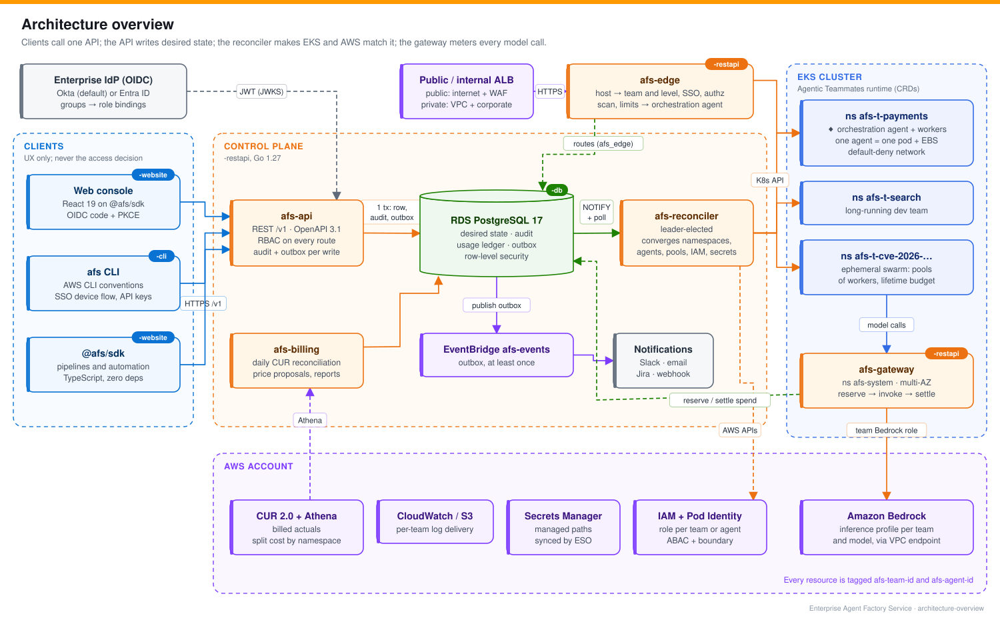

# enterprise-agent-factory-service-cli

**`afs`, the command line for the [Enterprise Agent Factory Service](https://github.com/stainedhead/enterprise-agent-factory-service).**
If you know the AWS CLI, you already know `afs`: `afs <service> <operation> --options`, named profiles,
`--output json|table|text|yaml|csv`, `--query` (JMESPath), automatic pagination, `--cli-input-json`,
`--generate-cli-skeleton` and AWS CLI exit codes. It talks only to the service's REST API, whose role-based
access decides what each user can do.

| | |
|---|---|
| **Use it** | [Getting started](user-docs/getting-started.md) · [Install](user-docs/install.md) · [Command reference](user-docs/reference/README.md) · [All user docs](user-docs/README.md) |
| **Understand it** | [Product summary](docs/product-summary.md) · [Technical details](docs/technical-details.md) · [Decisions](docs/architectural-decision-record.md) · [PRD](enterprise-agent-factory-service-cli-PRD.md) |
| **Change it** | [CONTRIBUTING.md](CONTRIBUTING.md) · [AGENTS.md](AGENTS.md) · [API contract](https://github.com/stainedhead/enterprise-agent-factory-service/blob/main/docs/contracts/api-contract.md) |



**Status:** feature complete against API contract 1.4 (milestones M0 to M12, release v1.1.0, which adds the team
orchestration agent and model access; see [Team orchestration](user-docs/orchestration.md)). All 194 operations of the pinned
contract are commands, with examples, table columns, golden help and output, and an `AccessDenied` test each, plus the
local commands `configure`, `configure sso`, `sso login`, `sso logout`, `completion` and `collaboration invoke-api`. The contract snapshot is pinned to
the final contract on `-restapi` `main` (`-restapi` commit `f6d240c`).

What every command gets: AWS-style global options, profiles, five output formats and `--query`, automatic pagination,
`--cli-input-json` and `--generate-cli-skeleton`, safe updates with `If-Match`, idempotent retries, `--wait`, a redacted
`--debug` log and AWS CLI exit codes. See [docs/product-summary.md](docs/product-summary.md) and
[docs/product-details.md](docs/product-details.md).

## Install

Build from source with `make build` until the first release is tagged; signed archives and Homebrew
(`brew install stainedhead/tap/afs`) follow it. See [Install](user-docs/install.md), then
[Getting started](user-docs/getting-started.md).

## Examples

```bash
afs configure sso                          # issuer, client id, endpoint for a profile
afs sso login --profile prod
afs teams list-teams --output table
afs agents list-agents --team-id team_01J... --query "items[?status.phase=='Running'].name"
afs budgets put-budget --team-id team_01J... --amount-usd 40000 --period monthly --thresholds 50 80 100
afs secrets create-secret --team-id team_01J... --name github-bot-key --scope team --secret-value file://key.pem
```

## How it works

Every operation is generated from the pinned OpenAPI contract, so the CLI cannot drift from the API, and
every invocation runs the same pipeline: parse, build, safe update with `If-Match`, send, paginate or wait,
render.



Secret values are accepted only from a file, standard input or a hidden prompt, never as an argument that
would land in shell history:



## Where it fits



## Build and test

```bash
make gate     # tidy, contract-check, generate-check, fmt-check, vet, lint, race tests, coverage (90%), build
./bin/afs help
```

Other targets: `make generate` (regenerate descriptors and types from `api/openapi.yaml`),
`make contract-sync RESTAPI_REF=<ref>` (re-pin the API snapshot), `make docs` (regenerate `user-docs/reference/`).

Releases are built by GoReleaser (`.goreleaser.yaml`, `.github/workflows/release.yml`): archives for five platforms, a
cosign-signed `checksums.txt`, and notarization, Authenticode signing and the Homebrew tap as soon as their secrets exist
(see [install](user-docs/install.md)). `afs completion bash|zsh|fish|powershell` prints a completion script.

## Documentation

User guides ([index](user-docs/README.md)):

| Guide | For |
|---|---|
| [Getting started](user-docs/getting-started.md) | Install, point `afs` at a service, sign in, first commands |
| [Install](user-docs/install.md) | Releases, verification, Homebrew, shell completion |
| [Configuration](user-docs/configuration.md) | Profiles, files, environment variables, precedence |
| [Single sign-on](user-docs/sso.md) | `afs configure sso`, `afs sso login`, refresh, logout |
| [Credentials](user-docs/credentials.md) | API keys, the credential order, the workload token |
| [Output](user-docs/output.md) | Output formats, `--query`, pager, colour |
| [Pagination](user-docs/pagination.md) | `--max-items`, `--starting-token`, `--page-size`, CSV |
| [Errors and exit codes](user-docs/errors-and-exit-codes.md) | Error format, exit codes, retries, `--debug` |
| [Troubleshooting](user-docs/troubleshooting.md) | Common problems and fixes |
| [Teams and members](user-docs/teams-and-members.md) | Usage examples: teams, members, audit, settings, identity providers |
| [Agents and secrets](user-docs/agents-and-secrets.md) | Usage examples: agents, secrets, configuration values, external systems |
| [Budgets and reports](user-docs/budgets-and-reports.md) | Usage examples: budgets, usage, reports and CSV, notification channels, models and prices |
| [Keys, tags, logs and administration](user-docs/delivery-and-admin.md) | Usage examples: API keys, role links, tags, log destinations, restore, schedules, exports |
| [Swarms](user-docs/swarms.md) | Usage examples: ephemeral teams, stages, pools, handoffs |
| [Work orders](user-docs/work-orders.md) | Usage examples: work orders, workers and the workload token, swarm templates |
| [kubectl access](user-docs/kubectl.md) | `afs teams get-kubeconfig` |
| [Command reference](user-docs/reference/README.md) | Every service and operation, generated from `afs help` |

Technical documentation: [product summary](docs/product-summary.md), [product details](docs/product-details.md),
[technical details](docs/technical-details.md), [architectural decisions](docs/architectural-decision-record.md).

## Contributing

Read [CONTRIBUTING.md](CONTRIBUTING.md) and the product-wide
[contributing guide](https://github.com/stainedhead/enterprise-agent-factory-service/blob/main/CONTRIBUTING.md).
The terminal images above are real `afs` output, rendered by `node docs/images/source/terminal-shots.mjs`
after `make build`. Why this repository exists: [INTENT.md](INTENT.md).
