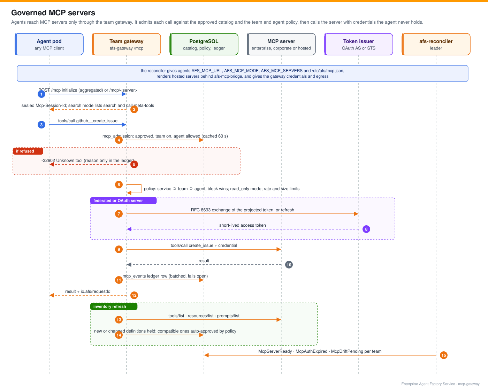

# Governed MCP servers

From release 1.3.0 (API contract 1.6), agents reach Model Context Protocol servers only through their team gateway.
Service admins and security operators keep the catalog; team admins switch servers on and narrow them per agent; the
gateway holds every credential. This guide shows the `afs` commands for each step. Every command is listed in the
[reference](reference/mcp-servers.md).



## Register and review a server (service admin, security operator)

```bash
afs mcp-servers create-mcp-server --slug github --display-name "GitHub" --owner platform-team \
  --purpose "Issues and pull requests" --data-classification internal --transport streamable_http \
  --location external --url https://api.githubcopilot.com/mcp/ --auth-kind static --credential-mode per_team
afs mcp-servers put-mcp-server-credential --mcp-server-id mcp_... --scope team_... --secret-value file://github.token
afs mcp-servers refresh-mcp-inventory --mcp-server-id mcp_...
afs mcp-servers list-mcp-reviews --approver security
afs mcp-servers approve-mcp-server --mcp-server-id mcp_... --note "Reviewed"
afs mcp-servers publish-mcp-server --mcp-server-id mcp_... --note "Available to all teams"
```

A hosted server (a stdio program run in the team namespace behind `afs-mcp-bridge`) takes `--transport hosted
--location in_namespace --hosted file://hosted.json` with an image pinned by digest. `import-mcp-server-manifest` reads a
`server.json` manifest instead.

Held definition changes: `list-mcp-primitives --status pending_review`, `get-mcp-primitive-change` (the diff and the
checks), then `approve-mcp-primitive` or `reject-mcp-primitive`. `suspend-mcp-server` stops every call within a minute;
`resume-mcp-server` and `retire-mcp-server` follow.

## Secrets

`--secret-value` (a static credential) and `--client-secret` (an OAuth client secret) are read only from
`file://PATH`, `fileb://PATH` or `-` (standard input), or asked for without echo. They are never plain arguments, never
printed, and redacted under `--debug`.

## Switch servers on for a team (team admin)

```bash
afs teams list-team-mcp-servers --team-id team_...
afs teams put-team-mcp-server --team-id team_... --mcp-server-id mcp_... --enabled --mode read_only
afs teams put-team-mcp-policy --team-id team_... --mcp-server-id mcp_... --rules '[{"name":"delete_*","effect":"block"}]'
afs teams start-mcp-oauth-connect --team-id team_... --mcp-server-id mcp_... --query authorizationUrl --output text
```

The team needs its own gateway (`afs teams put-team-gateway-settings --deployment per_namespace`). With
`--may-add-mcp-servers` a team can register its own servers: `create-team-mcp-server`, `submit-mcp-server-for-review`.

## Narrow servers per agent or pool

```bash
afs agents update-agent --team-id team_... --agent-id agt_... \
  --mcp '{"access":"selected","serverIds":["mcp_..."],"mode":"search"}'
afs agents get-effective-agent-mcp --team-id team_... --agent-id agt_... --query env --output text
```

`mode` is `full` (every allowed tool listed) or `search` (two meta-tools for large catalogs). The agent gets
`AFS_MCP_URL`, `AFS_MCP_MODE`, `AFS_MCP_SERVERS`, one `AFS_MCP_<SLUG>_URL` per server and `/etc/afs/mcp.json`.
`put-agent-federated-identity` projects a token for an external system that trusts the cluster's issuer.

## Ledger and reports

```bash
afs audit list-team-mcp-events --team-id team_... --outcome refused
afs reports get-mcp-usage-report --from 2026-08-27T00:00:00Z --to 2026-11-25T00:00:00Z --group-by server --view unused --window 90
```

Views: `usage`, `unused`, `refusals`, `discovery` and (service only) `adoption`. Each refusal reason has a hint in the
error output (see [Errors and exit codes](errors-and-exit-codes.md)).
